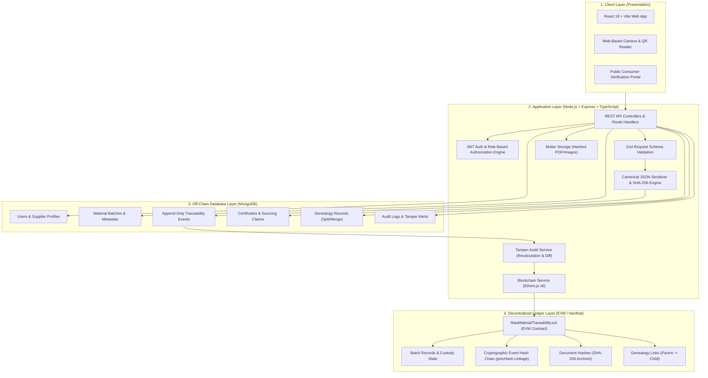
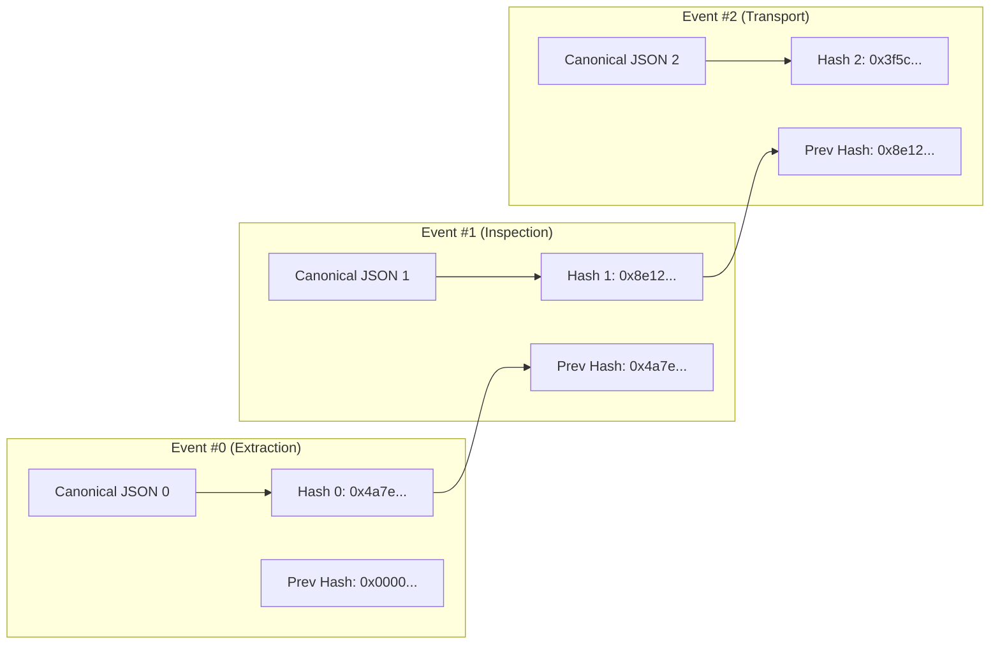

# System Architecture: Blockchain-Based Responsible Raw Material Traceability System

## 1. High-Level Architectural Model

The system follows a hybrid off-chain/on-chain architecture designed to overcome the classical storage and throughput limitations of public/private distributed ledgers while guaranteeing cryptographic non-repudiation and tamper evidence.

---

## 2. Off-Chain vs. On-Chain Design Tradeoffs

| Concern | Off-Chain (MongoDB + File Storage) | On-Chain (Solidity Smart Contract) |
| :--- | :--- | :--- |
| **Data Stored** | Full business entities, supplier coordinates, descriptions, notes, original PDF documents. | Canonical event hashes (`bytes32`), initial batch metadata, custodian addresses, document hashes. |
| **Privacy & GDPR** | Personal emails, confidential agreements, and contact details can be modified or purged under legal mandate. | Zero PII or confidential commercial data; only immutable mathematical proofs. |
| **Gas & Cost** | Zero gas fees; sub-millisecond query execution. | Minimal gas overhead (storing single 32-byte hashes instead of text blobs). |
| **Integrity Model** | Subject to potential silent database modification by compromised DBAs or attackers. | Immutable ledger; append-only; mathematically impossible to forge without private keys. |
| **Audit Verification** | Provides the raw content to re-serialize and compare against the on-chain anchor. | Acts as the definitive mathematical ground truth for detecting database tampering. |

---

## 3. Cryptographic Hash Chain Structure

Every traceability event includes the hash of the preceding event, forming an append-only linear chain analogous to a blockchain block header:

If an attacker alters `Event #0` in the database:
1. `Hash 0` recalculated from the altered data will no longer equal `0x4a7e...`.
2. Even if the attacker recalculates `Hash 0`, `Event #1`'s recorded `Prev Hash` will not match.
3. Even if the attacker updates `Event #1`, the on-chain smart contract anchor will immediately expose the tampering!
