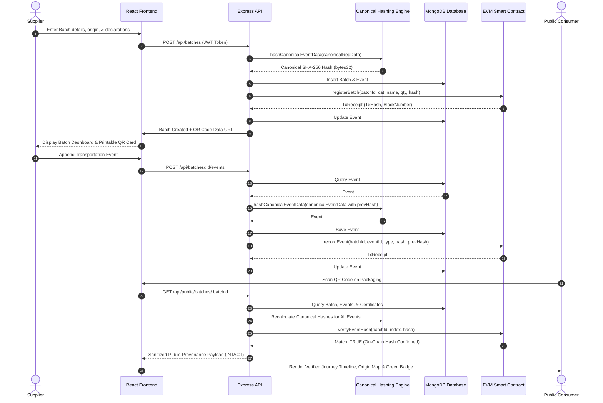

# Sequence Diagram: Batch Registration, Hashing, Anchoring, & QR Verification

This sequence illustrates the end-to-end cryptographic flow from supplier registration to public consumer verification.

