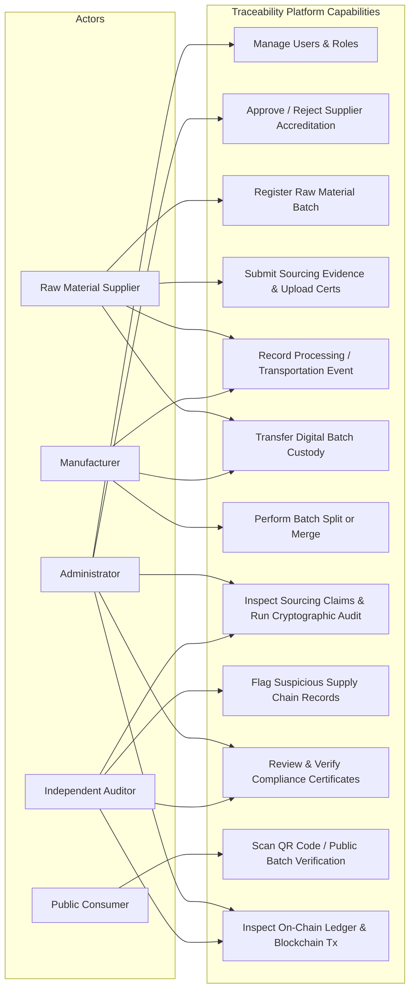

# System Use-Case Diagram

### Role Authorization Summary:
- **Administrator**: Approves suppliers, manages users, reviews system audit logs, and monitors ledger health.
- **Supplier**: Registers extraction batches with GPS coordinates, submits compliance certificates, appends initial events, and transfers custody.
- **Manufacturer**: Receives custody of batches, records processing and manufacturing events, splits batches into sub-lots, and merges input batches.
- **Auditor**: Reviews certificate validity, reviews supply chain event integrity, inspects smart contract hashes, and appends non-repudiable audit flags.
- **Consumer**: Scans QR codes without requiring login; accesses public provenance timelines, accredited certificate statuses, and fraud warnings.
